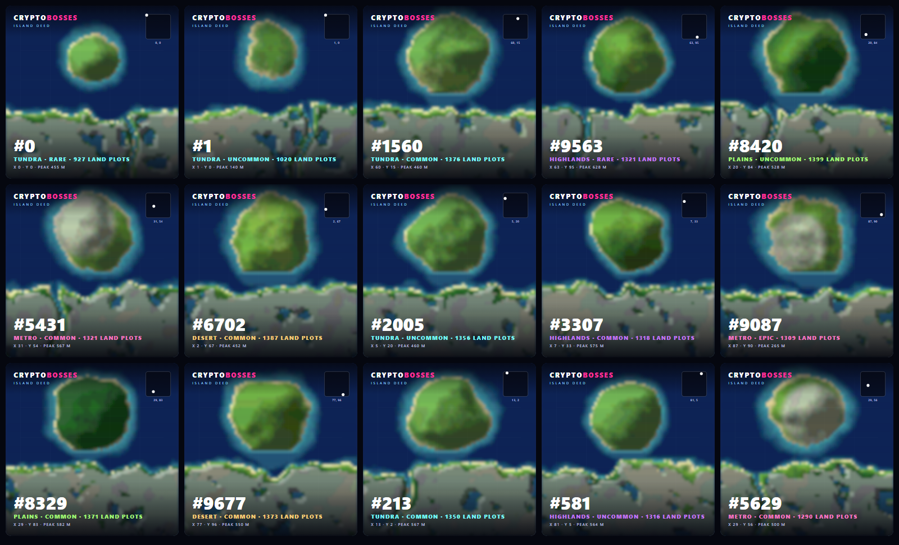
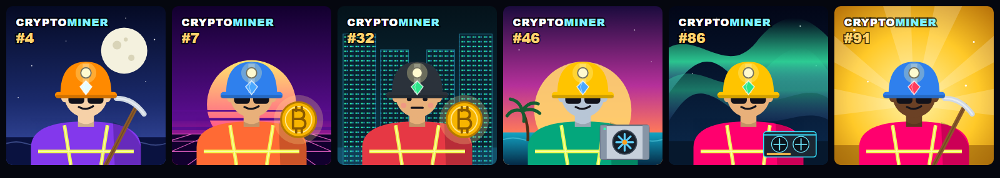
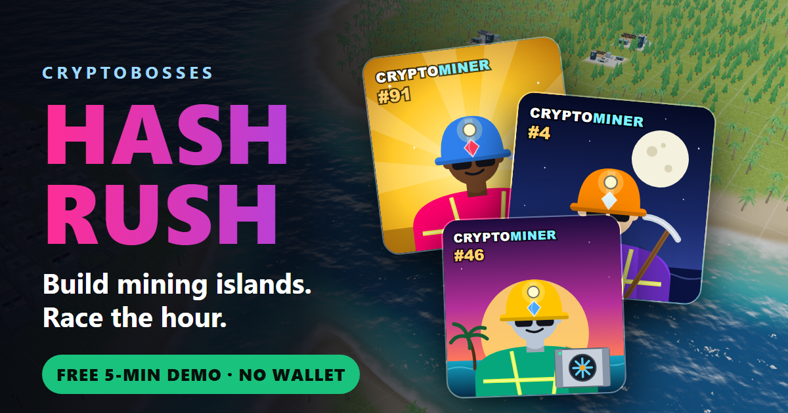

<div align="center">


# CryptoBosses

**Ten thousand islands. One archipelago. One hour at a time.**

<sub>The official repository of the CryptoBosses collection: provenance, verified source, brand assets and license.</sub>

<br/>

[](https://etherscan.io/token/0x4958b779bf6db003dd87f67f0fc89d049d227c17)
[](https://cryptobossesnft.com)
[](provenance/)
[](https://cryptobosses.xyz)

**[Collection](https://cryptobossesnft.com)** &nbsp;·&nbsp; **[Play HashRush](https://cryptobosses.xyz)** &nbsp;·&nbsp; **[Whitepaper](https://cryptobossesnft.com/whitepaper/)** &nbsp;·&nbsp; **[Verify provenance](provenance/)** &nbsp;·&nbsp; **[Contracts](#-contracts)**

<br/>



<sub>Island deeds #0, #1, #1560, #9563, #8420, #5431, #6702, #2005, #3307, #9087, #8329, #9677, #213, #581, #5629: the exact images served by the collection.</sub>

</div>

<br/>

## ◆ The world

| | | |
|:---:|:---:|:---:|
| 🏝️ **CryptoBosses** | ⛏️ **CryptoMiners** | ⚡ **HashRush** |
| 10,000 ERC-721 titles. Boss #N owns island #N of a 100 × 100 archipelago. | Open-supply ERC-721 game pass. One Miner, one account. Art drawn by the contract. | The browser game. Build power, chips, mining halls and AI datacenters in one-hour rounds. |
| [cryptobossesnft.com](https://cryptobossesnft.com) | [cryptobossesnft.com/#miners](https://cryptobossesnft.com/#miners) | [cryptobosses.xyz](https://cryptobosses.xyz) |

<br/>

## 🏝️ Islands

Every Boss is the title to one island, generated from a single shared map and frozen as an SVG deed. Each deed carries nine fixed traits:

`Biome` · `Rarity` · `Land Plots` · `Offshore Plots` · `Capacity` · `X` · `Y` · `Peak (m)` · `Distance to Capital`

| Biome | Islands | | Rarity | Islands |
|---|---:|---|---|---:|
| Plains | 4,123 | | Common | 5,046 |
| Tundra | 2,215 | | Uncommon | 2,999 |
| Highlands | 2,147 | | Rare | 1,219 |
| Desert | 1,374 | | Epic | 583 |
| Metro | 141 | | Legendary | 153 |

Sample deeds in full resolution: [`media/islands/`](media/islands/). Metadata: `https://cdn.cryptobossesnft.com/meta/{id}`.

<br/>

## ⛏️ CryptoMiners



The image and metadata of every Miner are produced **inside the contract** by `tokenURI()`: no server, no IPFS, nothing to go offline. Seven traits come from `keccak256(tokenId)`:

| Trait | Values |
|---|---|
| Background | Sunset · Night · Neon · Datacenter · Aurora · Gold Rush |
| Skin | Light · Medium · Tan · Brown · Dark · Robot |
| Helmet | Yellow · White · Orange · Blue · Red · Black |
| Vest | Orange · Blue · Red · Purple · Green · Pink · Teal · Lime |
| Face | Smile · Grin · Shades · Focused |
| Tool | Pickaxe · GPU · ASIC · Gold Coin |
| Gem | Emerald · Sapphire · Ruby · Diamond |

Odds of each value are listed at [cryptobossesnft.com/#miners](https://cryptobossesnft.com/#miners). Rarity describes the art only.

<br/>

## ⚡ HashRush



A real-time strategy game in the browser. Each hour (UTC) one island of the archipelago becomes the arena; players build energy, water, chip factories, mining halls and AI datacenters, and race for the ranking before the round ends.

- **Play:** [cryptobosses.xyz](https://cryptobosses.xyz) · **Free demo, no wallet:** [demo.cryptobosses.xyz](https://demo.cryptobosses.xyz/demo/)
- **Sign-in:** EIP-4361 (Sign-In with Ethereum), free and without a transaction. MetaMask, Coinbase, Trust, Rainbow and WalletConnect.
- **Round Tickets:** bought on-chain from `MinerRounds`, one transaction for 1 to 24 hours.

<br/>

## 📜 Contracts

All on Ethereum mainnet (chain id 1). Source verified on Etherscan.

| Contract | Address | Role |
|---|---|---|
| **CryptoBosses** `BOSS` | [`0x4958b779Bf6DB003DD87F67F0fc89d049d227C17`](https://etherscan.io/address/0x4958b779bf6db003dd87f67f0fc89d049d227c17) | the collection (2021, Solidity 0.7.6) · [source](contracts/CryptoBosses.sol) |
| **Crypto Miners** `MINER` | [`0xC7Aed3d7033c61112F52bFe9CBe842F15170f07c`](https://etherscan.io/address/0xC7Aed3d7033c61112F52bFe9CBe842F15170f07c) | game pass, on-chain art |
| MinerRounds | [`0x05082130001c9DC425fAc2592E231bCa4B41C6c1`](https://etherscan.io/address/0x05082130001c9DC425fAc2592E231bCa4B41C6c1) | Round Tickets and hourly settlement |
| RevenueSplitter | [`0x52e572B6e4c147e1Cc0BfA25Be4C19594F486027`](https://etherscan.io/address/0x52e572B6e4c147e1Cc0BfA25Be4C19594F486027) | fixed shares of every deposit |
| BossDistributor | [`0x3ff1F6C047f7c15E725A5462DaB11Ab04870F157`](https://etherscan.io/address/0x3ff1F6C047f7c15E725A5462DaB11Ab04870F157) | claims per Boss |
| MinerDistributor | [`0x21D15073ef4CBdf2A5b4339e191520209BA6359c`](https://etherscan.io/address/0x21D15073ef4CBdf2A5b4339e191520209BA6359c) | claims per Miner (created by Crypto Miners) |

The collection contract is the original one and is never modified by anything built around it. The newer contracts have no upgrade path; addresses are published only here, on the two official sites and in the whitepaper.

<br/>

## 🔐 Provenance

```
5bce3bceea9b28f3742c98cadb8e76d9fcb42e87e60aeae26347435b7dde29cc
```

That is `BOSS_PROVENANCE()` on the collection contract: the SHA-256 of the 10,000 per-island SHA-256 hashes, in order. Check it yourself:

```bash
git clone https://github.com/Jaguarbyte-Labs/CryptoBosses && cd CryptoBosses
node provenance/verify.mjs --ids 0-99
```

Per-island hashes, the full method and the original 2021 checksums: **[`provenance/`](provenance/)**.

<br/>

## 🗂️ Repository

```
.
├── contracts/
│   └── CryptoBosses.sol          verified source of the collection (0.7.6)
├── provenance/
│   ├── islands/
│   │   ├── PROVENANCE-HASH.txt   hash of all 10,000 islands (= on-chain)
│   │   ├── SHA256SUMS            one hash per island
│   │   └── provenance.txt        mirror of cdn.cryptobossesnft.com/provenance.txt
│   ├── original-2021/            checksums of the 2021 portraits (historical)
│   ├── verify.mjs                one-command verification
│   └── README.md
├── media/                        collage, deeds, Miners, game banner
├── logos/                        official logos (SVG and PNG)
├── SHA-256-Checksums             copy kept at the old path (links from 2021)
└── LICENSE.md                    holder license
```

<br/>

## 🎨 Brand

| File | Use |
|---|---|
| [`logos/cryptobosses-icon.svg`](logos/cryptobosses-icon.svg) | vector icon, green gem on black |
| [`logos/cryptobosses-icon-32.svg`](logos/cryptobosses-icon-32.svg) | token logo for block explorers (32 × 32) |
| `logos/cryptobosses-icon-32.png` · `-256.png` · `-512.png` | raster icons |
| [`logos/cryptobosses-mark.svg`](logos/cryptobosses-mark.svg) | the gem alone, transparent |
| [`logos/cryptobosses-banner-1200x630.png`](logos/cryptobosses-banner-1200x630.png) | social preview |

Gem `#2EE06A` · Night `#050805`

<br/>

## 💚 Support the project

Donations help pay for servers and development. They are voluntary, buy nothing and give no rights, rewards or priority.

| Network | Address |
|---|---|
| Ethereum (ETH and ERC-20) | [`0x00DacE6C60934CB27BB05319f22512BfDdFFa22e`](https://etherscan.io/address/0x00DacE6C60934CB27BB05319f22512BfDdFFa22e) |

Always copy the address from this page or from the official sites; nobody from the team will ever ask you to send funds in a private message.

<br/>

## ⚖️ License

Holders receive commercial rights to their own Boss. The names, logos and the game are not licensed. Full text: **[LICENSE.md](LICENSE.md)**.

<br/>

<div align="center">


### Created by Jaguarbyte Labs

CryptoBosses, CryptoMiners and HashRush are designed, built and published by **Jaguarbyte Labs**,<br/>an independent software studio. Verified source, no hidden switches.

[GitHub](https://github.com/Jaguarbyte-Labs) &nbsp;·&nbsp; [LinkedIn](https://www.linkedin.com/company/jaguarbyte-labs)

</div>

<br/>

---

<sub>**Notice.** CryptoBosses and CryptoMiners are digital collectibles and items of a game. Nothing here is an offer, financial advice or a promise of any return. In-game points have no value. The project has issued no fungible token: any token claiming otherwise is not ours. The only official sites are **cryptobossesnft.com** and **cryptobosses.xyz**.</sub>
