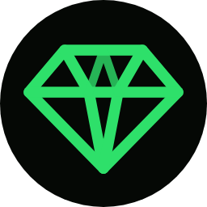
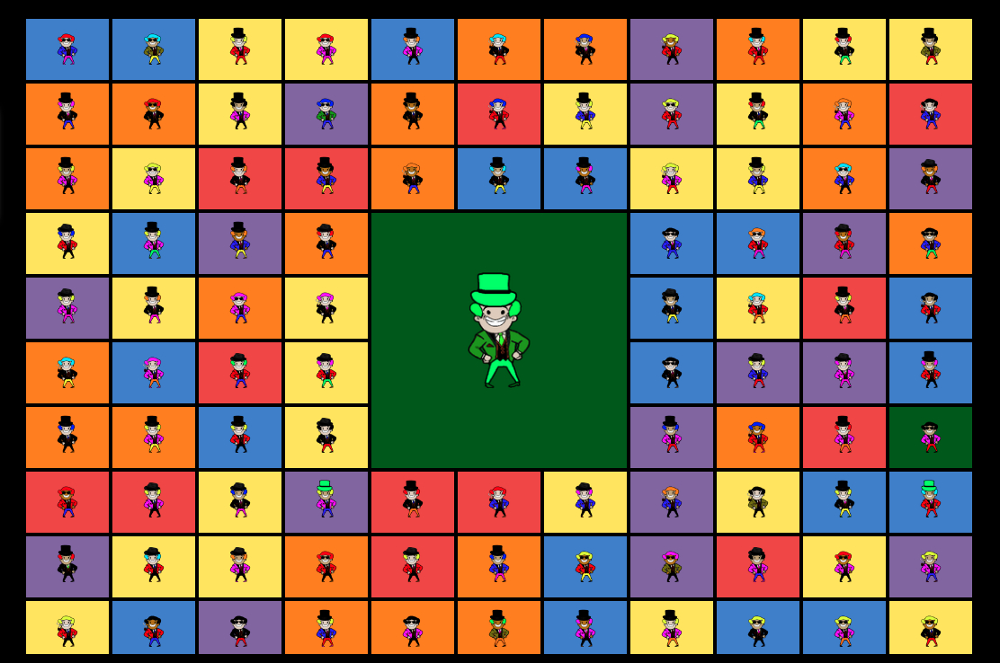

<p align="center">
  
</p>
<p align="center">
  <b>CryptoBosses: official assets, license and provenance</b>
  <br><i>10,000 Bosses on Ethereum. Each Boss is the title to one island of an archipelago.</i>
</p>

<p align="center"><a></a></p>

## What is CryptoBosses

CryptoBosses (symbol `BOSS`) is an ERC-721 collection of **10,000 Bosses** on Ethereum mainnet. Island number N belongs to Boss number N, on a grid of 100 x 100 islands. A Boss is the title to an island: when the clock of [HashRush](https://cryptobosses.xyz) selects that island, it hosts a one-hour round of the game. The collection contract is the original one and is not modified by anything built around it.

CryptoBosses and CryptoMiners are digital collectibles and items of a game. Nothing here is an offer, advice or a promise of any return. The project has issued no fungible token; any token claiming otherwise is not ours.

## Official links

| | |
|---|---|
| Collection and mint | https://cryptobossesnft.com |
| Game (HashRush) and CryptoMiners | https://cryptobosses.xyz |
| Free demo of the game | https://demo.cryptobosses.xyz/demo/ |
| Whitepaper (Edition II) | https://cryptobosses.xyz/whitepaper/ (PDF: https://cryptobosses.xyz/whitepaper.pdf) |
| Collection on Etherscan | https://etherscan.io/address/0x4958b779bf6db003dd87f67f0fc89d049d227c17 |
| OpenSea | https://opensea.io/collection/crypto-bosses-nft |
| Rarible | https://rarible.com/cryptobosses |

## Official contract

| Contract | Network | Address |
|---|---|---|
| CryptoBosses (`BOSS`, ERC-721, Solidity 0.7.6, verified) | Ethereum mainnet | `0x4958b779Bf6DB003DD87F67F0fc89d049d227C17` |

CryptoMiners, Round Tickets and the revenue contracts run on the Sepolia test network only. Their mainnet addresses will be published here and on the two official sites, and nowhere else. `CryptoBosses.sol` in this repository is the verified source of the collection contract.

## Brand assets (`logos/`)

| File | Use |
|---|---|
| `cryptobosses-icon-32.svg` | token logo for block explorers (32x32 SVG) |
| `cryptobosses-icon.svg` | vector icon (green gem on a black circle) |
| `cryptobosses-icon-32.png`, `-256.png`, `-512.png` | raster icons (`CB_Logo_32x32.png` is the original 32x32) |
| `cryptobosses-mark.svg` | the gem alone, transparent background |
| `cryptobosses-banner-1200x630.png` | social preview image |

Colors: gem `#2EE06A`, background `#050805`.

Donations: 0x00DacE6C60934CB27BB05319f22512BfDdFFa22e

### LICENSE

ONLY AND EXCLUSIVELY CRYPTOBOSSES HOLDERS are given commercial rights to their specific boss. You can sell its likeness or make derivatives of it. You can give others permission to use it. It’s yours. You are free to do anything with them under a non-exclusive or exclusive license.

We’ve given licensing rights over for the bosses, but not our logo, name (Crypto Bosses), site images, or other marketing material. Basically, if it isn’t your Boss, it isn’t your Intellectual Property.

We don’t mind personal use or fan art usage of our logos and brand, just so long as you don’t try and sell them. The bottom line here is to protect the club, it is important that someone can’t pretend to be Crypto Bosses and that they can’t pretend to be collaborating with us.

### Original collection images

The 10,000 original images (10,000 x 10,000 px) were published with the checksums below, and their provenance hash is part of the collection contract. The island titles used by the game have their own provenance hash, published at https://cryptobossesnft.com.

### SHA256-SUM

https://raw.githubusercontent.com/Jaguarbyte-Labs/CryptoBosses/main/SHA-256-Checksums

`SHA-256-Checksums` lists one hash per image, `./0.png` to `./9999.png` (press Ctrl+F and type `./{TOKEN_ID}.png`).

```
SHA-256 PROVENANCE HASH OF ALL IMAGES TOGETHER = 256a0598e63be92783e2983a9156f42989c0c91d1226faae578d632ff5f64aa8
```
